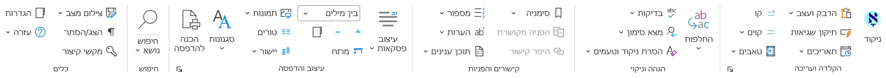

  <strong>משתמשים חדשים בגיטהאב? לא יודעים אנגלית היטב?</strong> 👈 <a href="guide-he.md">לחצו כאן למדריך בעברית</a>

# עזרים לוורד (WordAccessories) 📝

תוסף (Add-in) ל-Microsoft Word שמקצר את הדרך מכתב יד ועד ספר מוכן לדפוס, ומוסיף כלים שחסרים בוורד לעבודה בעברית. מה שבוורד דורש כמה חלונות וחזרה על אותם צעדים – לפעמים מאות צעדים מייגעים – מתבצע בלחיצה אחת. התוסף מיועד במיוחד למחברים ועורכי ספרים (גם ספרי קודש), קלדנים, מורים, ולכל מי שמרבה לעבוד עם טקסטים ארוכים בעברית.

## ⭐ חדש בגירסה 4.0
* **הכנה להדפסה** מהירה בהרבה, עם דוח איזון טורים ותוכן עניינים גם למסמך שאין בו.
* **עיצוב כותרות עמוד** כמו בספרי קודש, עם תצוגה מקדימה של ספר פתוח.
* **סדר בסגנונות:** מברשת סגנון, מעבר מעיצוב ידני לסגנונות, איחוד וניקוי סגנונות.
* **צילום מצב:** נקודת חזרה בטוחה לפני כל שינוי גדול, עם השוואה ושחזור.
* **חיפוש** שמוצא יותר: כתיב מלא וחסר, אותיות סופיות, מילים שלא יופיעו, ותצוגת תוצאות חדשה.
* **המרת תאריכים** עבריים ולועזיים, בשילוב "רב לוח".

כל החידושים – בעמוד ה-[Releases](../../releases).

## ✨ תכונות וכלים עיקריים

### 🖨️ הכנה להדפסה בלחיצה
מהמסמך לספר מוכן לדפוס – על עותק, כך שהמקור נשאר נקי ונוח לעריכה. טורים, יישור טורים בכל העמודים, מספור הערות באותיות, כותרות עמוד ותוכן עניינים מתבצעים בבת אחת, ובסוף מוצג דוח: מה נעשה בכל עמוד, ותמונה של עמוד שנשאר לא מיושר. מספרי עמודים באותיות עבריות גם מעל 392, וייצוא ל-PDF ול-PDF/A.

### 🔍 חיפוש נושא מתקדם
"איפה כתבתי על...?" – מנוע חיפוש עצמאי ומהיר שמאתר נושא לפי מילות מפתח בכל סדר, במסמך הנוכחי או בתיקיות שלמות (כולל תתי-תיקיות), בלי אינדקס מראש.
* טווח לפי פסקאות או מילים, לפי הסדר או בכל סדר.
* צמדי מילים, מילים חלופיות, ומילים שלא יופיעו בתוצאה.
* כתיב מלא או חסר (`~דוד` מוצא גם "דויד"), ואותיות סופיות כרגילות ("מלך" מוצא גם "מלכים").
* גם בהערות שוליים וסיום, בכותרות עליונות ותחתונות ובתיבות טקסט.
* בתיקייה: קבצי docx,‏ doc,‏ rtf ו-txt, עם מטמון שמאיץ את החיפושים הבאים.

### 🎨 סגנונות
* **מברשת סגנון:** מסמנים שמות ספרים, מראי מקומות וציטוטים תוך כדי קריאה, וההדגשות שבטקסט נשמרות.
* **מעיצוב ידני לסגנונות:** העיצוב הידני בכל המסמך מוחלף בסגנונות מסודרים, תוך שניות.
* **איחוד סגנונות כפולים** ("ציטוט", "ציטוט2"...) ו**ניקוי סגנונות** שאינם בשימוש.

### 🔄 החלפות ותיקונים
* **הדבק ועצב:** הדבקת טקסט ממאגר או מ-PDF עם סגנון ותיקונים (כמו הסרת מעברי שורה), בפעולה אחת.
* **ניקוי שיבושים:** תיקון טקסט סרוק (OCR) או מיובא – מעברי שורה, רווחים כפולים, גרשיים, טקסט עברי הפוך.
* **החלפות משתמש:** יצירה, שמירה והפעלה של סדרת החלפות בבת אחת, עם בונה תבניות לתווים כלליים ולעיצוב.
* **בדיקות:** סוגריים חסרים והפניות שבורות.

### 📑 כותרות עמוד, תוכן עניינים והפניות
* **עיצוב כותרות עמוד** כמו בספרי קודש: שם הספר, הפרק ומספר העמוד – כל אחד בעמודה משלו, ומספר העמוד בצד החיצוני. כותרת רצה מכל סגנון, וקו מפריד לבחירה.
* **מפריד הערות:** עיצוב הקו שמעל ההערות.
* **תוכן עניינים כטקסט**, שאינו מכביד על מסמכים ארוכים, והוספת ערכים בלי תלות בסגנונות כותרת.
* **סימניות והפניות מקושרות** בשתי לחיצות.

### 🖋️ הקלדה ועריכה
* **ניקוד מהיר:** הסמן עובר לאות הבאה אחרי הזנת תנועה, תיקון ניקוד בלחיצה, דגש, רפה וקמץ קטן.
* **תיקון שגיאות וקיצורים:** הוספת מילה לתיקון האוטומטי עם כל אותיות השימוש (בכל"מ) בבת אחת, ויומן שינויים.
* **המרת תאריכים:** תאריך עברי או לועזי מומר ללוח השני בכמה ניסוחים (נדרשת התקנת "רב לוח").
* **קווים למילוי:** קווים ישרים (כולל מספור) עד סוף השורה – למבחנים וטפסים.

### 📄 עימוד, טורים ותמונות
* **טורים:** מסמך שלם בשני טורים בלחיצה, והכותרות בטור אחד; יישור טורים חכם בסוף העמוד.
* **כוונון עדין** של גופן, פסקה ושוליים להתאמה מושלמת לעמוד.
* **תמונות:** התאמה לרוחב העמוד, ופיצול תמונות ארוכות (למשל עמוד שהועתק מאוצר החכמה) לשני עמודים.

### 🔢 הערות ומספור עברי
* הורדת קטע להערת שוליים, והעלאת הערות לגוף הטקסט.
* מספור עמודים והערות שוליים באותיות עבריות, גם מעל 392 – פתרון לבאג המוכר בוורד.
* מספור אוטומטי מתקדם (SEQ), עם סגנון לכל רצף.

### 📸 צילום מצב
שמירת עותק של המסמך כפי שהוא ברגע זה, גם עם שינויים שלא נשמרו – לפני שמנסים שינוי גדול. השוואה עם סימוני שינויים ושחזור בלחיצה. מנהל ההחלפות וכלי הסגנונות מצלמים את המסמך לבד לפני שהם מתחילים.

## 💻 דרישות מערכת
* **מערכת הפעלה:** תואם לסביבת Windows.
* **גרסת אופיס:** תומך בכל גרסאות Microsoft Word, החל מגרסת **Word 2007** ועד לגרסאות החדשות ביותר (כולל Office 365).
* **המרת תאריכים:** נדרשת התקנת "רב לוח" (גירסה 2.2 ומעלה; מומלץ 3.0).

## 🚀 הורדה והתקנה
תהליך ההתקנה הוא פשוט ומהיר:
1. היכנסו לעמוד ה-[Releases](../../releases) כאן ב-GitHub.
2. הורידו את קובץ ההתקנה של הגרסה העדכנית ביותר.
3. הפעילו את הקובץ שירד ופעלו לפי ההוראות שעל המסך. אם וורד פתוח, המתקין סוגר אותו בעדינות ושואל על מסמכים שלא נשמרו.
4. בסיום ההתקנה, פתחו את תוכנת Word ותראו את הכרטיסייה החדשה.

> **הערה לגבי רישוי:** התוסף זמין להתנסות ללא עלות למשך 30 יום. לאחר מכן, נדרשת תרומה כדי להמשיך להשתמש בו, ראה פרטים במסך 'אודות' של התוסף.

## ❓ תמיכה טכנית ועזרה
לכל כלי יש הסבר מפורט בעזרה שבתוך התוסף ("עזרה" ברצועת הכלים). בנוסף, השתמשו בכלים המובנים של GitHub כדי לעזור אחד לשני!
* **שאלות והדרכות:** יש לכם שאלה על איך להשתמש באחת הפונקציות? היכנסו ל-[דיונים (Discussions)](../../discussions). חפשו אם מישהו כבר שאל את השאלה, או פתחו דיון חדש.
* **דיווח על באגים:** אם מצאתם תקלה טכנית בתוסף, אנא פתחו קריאה מסודרת בלשונית [Issues](../../issues) והשתמשו בתבנית הדיווח.
* *לתשומת לבכם: התמיכה הטכנית מתבצעת **אך ורק דרך GitHub**.*

## ✉️ יצירת קשר
לנושאים שאינם קשורים לתמיכה טכנית, ניתן לפנות לדוא"ל: elischein@gmail.com

